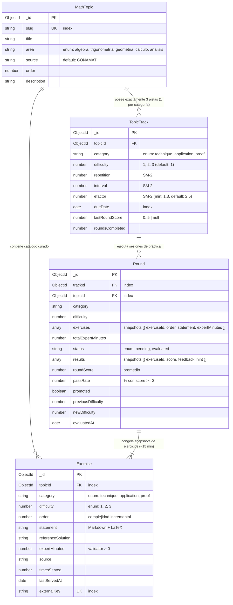
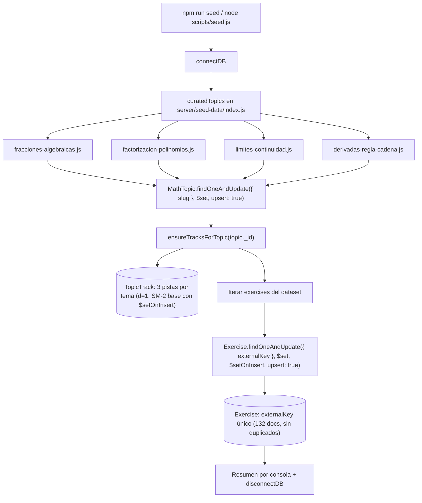
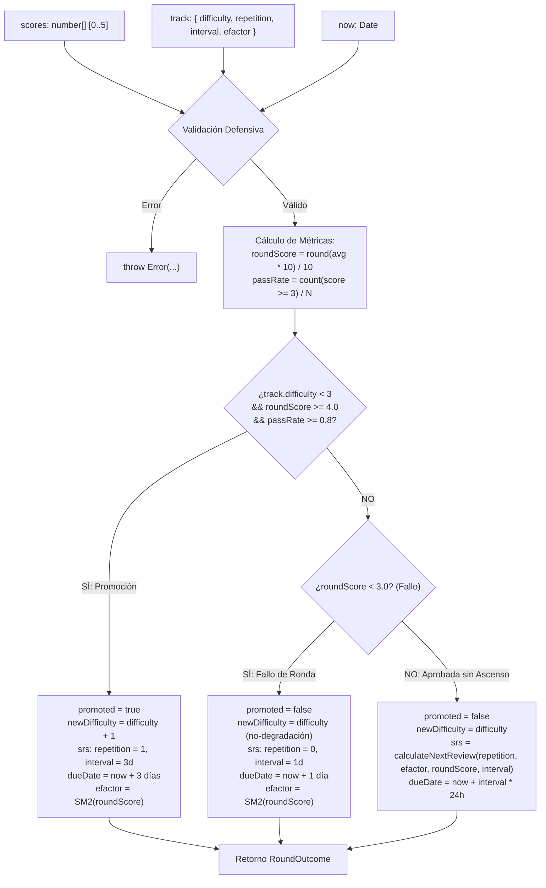
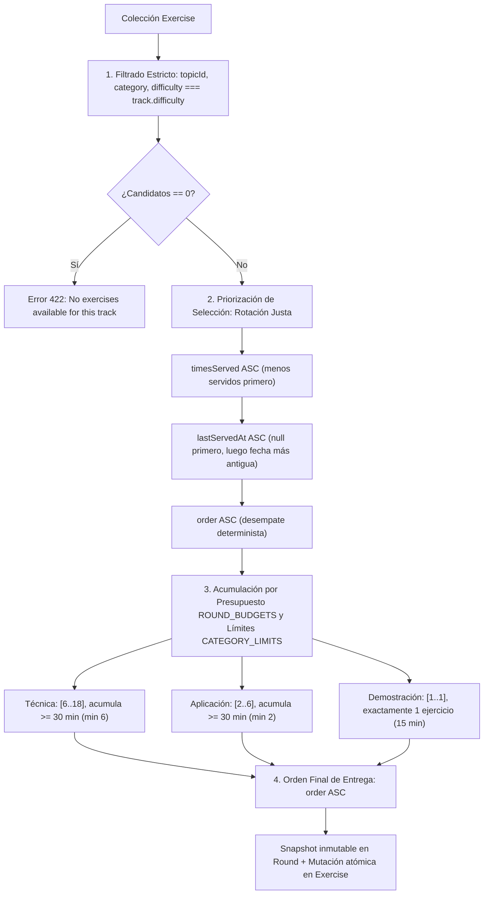
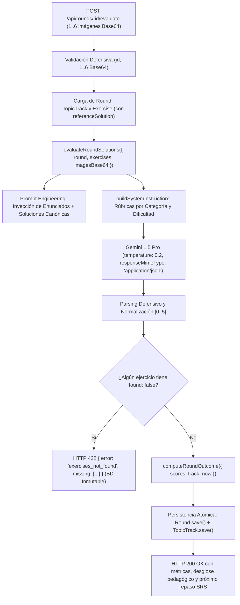
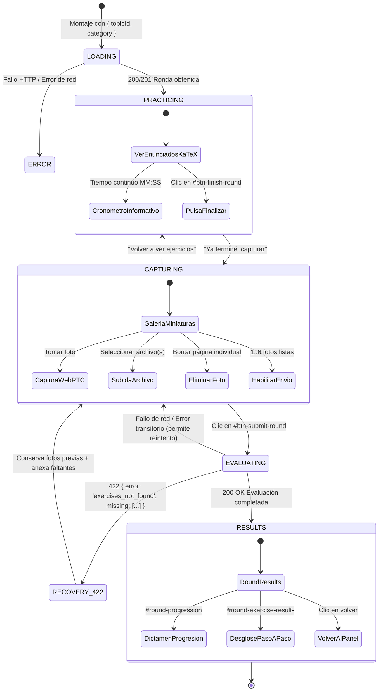

# Arquitectura Técnica del Sistema: MathCoach Sparring

Este documento describe la arquitectura modular, los contratos de API, el modelo de datos relacional sobre MongoDB/Mongoose y el flujo de evaluación multimodal de **MathCoach Sparring**.

---

## 1. Topología del Monorepo

El repositorio está estructurado como un monorepo NPM con separación estricta de responsabilidades entre cliente y servidor:

```text
mathcoach-sparring/
├── client/                     # Frontend SPA en Vite + React 18 + Tailwind CSS + KaTeX
│   ├── src/
│   │   ├── components/         # MathVisionUploader, MathStatement, Dashboard, RoundSession
│   │   ├── constants/          # categories.js (technique, application, proof)
│   │   ├── App.jsx             # Shell de navegación principal (Entrenar / Panel)
│   │   ├── main.jsx            # Entry point
│   │   └── index.css           # Estilos base y utilidades
│   ├── tests/                  # Pruebas unitarias e integración en Vitest + Testing Library
│   ├── index.html
│   ├── vite.config.js
│   └── package.json
├── server/                     # Backend API en Node.js (ESM) + Express + Mongoose
│   ├── src/
│   │   ├── config/             # categories.js, progression.js
│   │   ├── controllers/        # dashboardController.js (agregación de pistas, SRS y matriz)
│   │   ├── models/             # MathTopic.js, Exercise.js, TopicTrack.js, Round.js
│   │   ├── routes/             # health.js, topics.js, practice.js, rounds.js
│   │   ├── services/           # trackService.js, geminiService.js, roundBuilder.js
│   │   ├── utils/              # srsCalculator.js, progressionEngine.js
│   │   ├── app.js              # Express app y montaje de routers
│   │   ├── db.js               # Conexión defensiva a MongoDB con serverSelectionTimeoutMS
│   │   └── server.js           # Bootstrap del servidor HTTP
│   ├── tests/                  # Pruebas con Vitest, Supertest y MongoMemoryServer
│   │   ├── models.test.js      # Validación exhaustiva de los 4 modelos y trackService
│   │   ├── topics.test.js      # Validación del contrato GET /api/topics con pistas
│   │   ├── roundEvaluation.test.js # Evaluación multimodal de rondas POST /api/rounds/:id/evaluate
│   │   └── srsCalculator.test.js
│   └── package.json
├── tests/
│   └── e2e/                    # Pruebas End-to-End con Playwright (00-smoke, 01-round-session, 02-progression-dashboard)
├── docs/                       # Documentación técnica (ARCHITECTURE.md, USER_GUIDE.md)
├── tickets/                    # Registro formal de especificaciones y evidencias de historias
├── graphify-out/               # Knowledge graph del repositorio generado por Graphify
├── playwright.config.js        # Orquestación de webServer y ejecución E2E
└── package.json                # Configuración de workspaces NPM y scripts globales
```

---

## 2. Modelo de Dominio y Esquemas de Persistencia (Mongoose)

El backend implementa la matriz tridimensional **Tema × Categoría × Dificultad** desacoplando la unidad conceptual (`MathTopic`) del ejercicio individual (`Exercise`), el seguimiento de memoria (`TopicTrack`) y la sesión de práctica (`Round`).



### 2.1 Esquema `MathTopic` (`server/src/models/MathTopic.js`)
Unidad curricular de contenido. No almacena enunciados particulares ni campos de repetición espaciada:
- **`slug`**: String único e indexado, normalizado en minúsculas (ej. `'fracciones-algebraicas'`).
- **`title`**: String requerido con el nombre legible del tema.
- **`area`**: Restringida estrictamente al enum: `['algebra', 'trigonometria', 'geometria', 'calculo', 'analisis']`.
- **`source`**: Cadena informativa (ej. `'CONAMAT'`, `'Stewart'`, `'Spivak'`).
- **`order`**: Orden pedagógico general dentro de su área matemática.
- **`description`**: Breve síntesis curricular de los conceptos abarcados.

### 2.2 Esquema `Exercise` (`server/src/models/Exercise.js`)
Problema concreto para ser resuelto en libreta física:
- **`topicId`**: Referencia obligatoria `ObjectId` hacia `MathTopic`.
- **`category`**: Enum `['technique', 'application', 'proof']`.
- **`difficulty`**: Entero `1`, `2` o `3`.
- **`order`**: Complejidad creciente dentro de su par *(categoría, dificultad)*.
- **`statement`**: Texto en Markdown con notación matemática LaTeX delimitada por `$ ... $` o `$$ ... $$`.
- **`referenceSolution`**: Criterio de resolución técnica y rubro para la evaluación con IA.
- **`expertMinutes`**: Número mayor a cero que representa los minutos estimados que un experto tarda en resolverlo. Validador defensivo: `v > 0`.
- **`timesServed`** y **`lastServedAt`**: Metadatos de rotación para evitar servir los mismos ejercicios repetidamente.
- **`externalKey`**: Cadena única e indexada para garantizar un sembrado (seeding) 100% idempotente (ej. `'alg-frac-tech-d1-01'`).
- **Índice Compuesto:** `{ topicId: 1, category: 1, difficulty: 1, order: 1 }` para selección y paginado instantáneo de rondas.

### 2.3 Esquema `TopicTrack` (`server/src/models/TopicTrack.js`)
Mantiene el progreso adaptativo para el par único *(Tema × Categoría)*:
- **`topicId`**: Referencia hacia `MathTopic`.
- **`category`**: Enum `['technique', 'application', 'proof']`.
- **`difficulty`**: Dificultad actual de la pista (`1`, `2` o `3`, por defecto `1`).
- **Campos SRS (SM-2):** `repetition` (default 0), `interval` (default 0), `efactor` (default 2.5, min 1.3), `dueDate` (Date, default `Date.now`).
- **Métricas:** `lastRoundScore` (0 a 5 o null) y `roundsCompleted` (conteo histórico).
- **Índice Compuesto Único:** `{ topicId: 1, category: 1 }` (garantiza que existan exactamente 3 pistas por tema).
- **Índice Secundario:** `{ dueDate: 1 }` para la consulta eficiente de la cola diaria de repasos.

### 2.4 Esquema `Round` (`server/src/models/Round.js`)
Sesión de práctica que agrupa ~15 minutos de tiempo experto:
- **Snapshots Inmutables:** Los ejercicios seleccionados se congelan en el array `exercises` (`exerciseId`, `order`, `statement`, `expertMinutes`), garantizando que la ronda no cambie aunque el catálogo se actualice.
- **Estado:** `status: 'pending'` (en progreso de resolución por el alumno) o `'evaluated'` (calificada por la IA).
- **Resultados:** `results` almacena los puntajes individuales (0 a 5), `feedback_paso_a_paso` y pistas socráticas.
- **Veredicto:** `roundScore`, `passRate`, `promoted`, `previousDifficulty`, `newDifficulty` y `evaluatedAt`.

---

## 3. Servicio Idempotente `ensureTracksForTopic`

Ubicado en `server/src/services/trackService.js`, garantiza que cualquier tema nuevo cuente de inmediato con sus 3 pistas operativas sin duplicar documentos ni reiniciar el avance existente:

```javascript
export async function ensureTracksForTopic(topicId) {
  if (!topicId) throw new Error('topicId is required');

  const tracks = await Promise.all(
    VALID_CATEGORIES.map(async (category) => {
      return TopicTrack.findOneAndUpdate(
        { topicId, category },
        {
          $setOnInsert: {
            topicId,
            category,
            difficulty: 1,
            repetition: 0,
            interval: 0,
            efactor: 2.5,
            dueDate: new Date(),
            lastRoundScore: null,
            roundsCompleted: 0,
          },
        },
        { upsert: true, new: true, setDefaultsOnInsert: true }
      );
    })
  );

  return tracks;
}
```

---

## 4. Pipeline de Siembra Idempotente y Catálogo Curado (`server/scripts/seed.js`)

Para asegurar la disponibilidad inmediata de material pedagógico formal sin recurrir a scripts monolíticos frágiles, el sistema cuenta con un pipeline de siembra desacoplado y estrictamente idempotente.



### 4.1 Modularidad de Datasets Curados (`server/seed-data/`)

Los datos están divididos en archivos independientes por tema matemático que exportan un contrato común `{ slug, metadata, exercises }`:
- **`fracciones-algebraicas.js`**: Álgebra CONAMAT (33 ejercicios).
- **`factorizacion-polinomios.js`**: Álgebra CONAMAT (33 ejercicios).
- **`limites-continuidad.js`**: Cálculo / Análisis Stewart / Spivak (33 ejercicios).
- **`derivadas-regla-cadena.js`**: Cálculo / Análisis Stewart / Spivak (33 ejercicios).
- **`index.js`**: Reúne y exporta el array canónico `curatedTopics`.

### 4.2 Estrategia de Idempotencia Estricta con `externalKey`

1. **Upsert Atómico de Temas:**
   - Criterio de unicidad: `{ slug: topicData.slug }`.
   - Modificador: `$set` con los atributos `metadata` (`title`, `area`, `source`, `order`, `description`).
2. **Inicialización de Pistas (`ensureTracksForTopic`):**
   - Emplea `$setOnInsert` para inicializar dificultad en 1 y valores SM-2 base (`repetition: 0, interval: 0, efactor: 2.5`). Si el estudiante ya tiene un progreso de repaso acumulado, este no se sobreescribe ni se reinicia.
3. **Upsert Atómico de Ejercicios por `externalKey`:**
   - Criterio de unicidad: `{ externalKey: exData.externalKey }` (ej. `'alg-frac-tech-d1-01'`).
   - Modificador: `$set` asociando `topicId: topic._id`, `category`, `difficulty`, `order`, `statement`, `referenceSolution`, `expertMinutes` y `source`.
   - Modificador `$setOnInsert`: Establece `timesServed: 0` y `lastServedAt: null`. De este modo, re-ejecutar el seed en un entorno en producción conserva los contadores de servicio y rotación de ejercicios.
4. **Duplicidad Cero ($\Delta N = 0$):**
   - Ejecutar `npm run seed` $N$ veces consecutivas mantiene exactamente:
     $$\Delta N_{\text{MathTopic}} = 0, \quad \Delta N_{\text{TopicTrack}} = 0, \quad \Delta N_{\text{Exercise}} = 0$$

### 4.3 Garantía de Volumen para el Constructor de Rondas

El diseño del catálogo garantiza las cuotas operativas exigidas por la regla de negocio §1.1 para armar rondas de ~15 minutos de tiempo experto:

| Categoría | Presupuesto por Ronda | Cuota Mínima por (Tema, Dificultad) | Minutos Mínimos por (Tema, Dificultad) | Capacidad de Generación Disjunta |
|---|---|---|---|---|
| **Técnica** | 3 a 10 ejercicios ($\ge 15$ min) | 6 ejercicios | $\ge 30$ min acumulados | Permite armar Ronda 1 ($\ge 3$ ex, $\ge 15$ min) y Ronda 2 ($\ge 3$ ex, $\ge 15$ min) **sin repetir ejercicios**. |
| **Aplicación** | 1 a 3 ejercicios ($\sim 15$ min) | 3 ejercicios | $\ge 20$ min acumulados | Permite armar al menos 2 rondas de aplicación distintas. |
| **Demostración** | Exactamente 1 ejercicio (8–15 min) | 2 ejercicios | $\ge 16$ min acumulados | Ronda 1 consume el primer problema; Ronda 2 consume el segundo de forma disjunta. |

---

## 5. Motor de Progresión Adaptativa y Acoplamiento SRS (`progressionEngine.js`)

El módulo `server/src/utils/progressionEngine.js` gobierna la progresión de dificultad y el cálculo de la próxima fecha de repaso tras evaluar una ronda de práctica.

Está diseñado siguiendo el patrón arquitectónico de **núcleo funcional puro (Functional Core)**:
- **Cero Efectos Secundarios:** No realiza operaciones de entrada/salida (E/S), no accede a colecciones de MongoDB ni interactúa con Express o llamadas a modelos de IA.
- **Determinismo y Testabilidad:** El 100% de sus cómputos son funciones puras $f(\text{scores}, \text{track}, \text{now}) \to \text{outcome}$, lo que permite pruebas unitarias instantáneas con Vitest y reproducibilidad matemática total.



### 5.1 Centralización de Constantes y Umbrales (`server/src/config/progression.js`)

Todos los valores numéricos y reglas de corte están desacoplados del código algorítmico y centralizados en `server/src/config/progression.js`:

```javascript
export const PROMOTION_MIN_SCORE = 4.0;       // Nota promedio mínima para promoción (escala 0-5)
export const PROMOTION_MIN_PASS_RATE = 0.8;    // Proporción mínima de ejercicios aprobados (>= 3)
export const PROMOTION_INTERVAL_DAYS = 3;      // Intervalo de repaso corto tras ascender de nivel
export const ROUND_BUDGET_MIN = 15;            // Presupuesto experto legado / fallback por ronda (minutos)
export const ROUND_BUDGETS = {                 // Presupuestos expertos por categoría (minutos)
  technique: 30,
  application: 30,
  proof: 15,
};
export const EXERCISE_PASS_SCORE = 3;          // Corte individual de ejercicio aprobado
export const ROUND_PASS_SCORE = 3.0;           // Corte global para evitar reinicio SM-2
export const MIN_DIFFICULTY = 1;               // Dificultad base
export const MAX_DIFFICULTY = 3;               // Tope adaptativo máximo
export const CATEGORY_LIMITS = {               // Límites de cantidad de ejercicios por categoría
  technique: { min: 6, max: 18 },
  application: { min: 2, max: 6 },
  proof: { min: 1, max: 1 },
};
```

### 5.2 Contrato Funcional de `computeRoundOutcome`

```typescript
interface ComputeRoundOutcomeParams {
  scores: number[];                          // Calificaciones individuales de la ronda (0 a 5)
  track: {
    difficulty: number;                      // 1, 2 o 3 (obligatorio)
    repetition?: number;                     // Etapa de repeticiones previas (default: 0)
    interval?: number;                       // Intervalo previo en días (default: 0)
    efactor?: number;                        // Factor de facilidad previo (min 1.3, default: 2.5)
  };
  now?: Date | number;                       // Instante base inyectable (default: new Date())
}

interface RoundOutcome {
  roundScore: number;                        // Promedio aritmético redondeado formalmente a 1 decimal
  passRate: number;                          // Proporción de ejercicios con calificación >= 3 (0.0 a 1.0)
  promoted: boolean;                         // true si asciende a la siguiente dificultad
  newDifficulty: number;                     // 1, 2 o 3 (garantía: newDifficulty >= track.difficulty)
  srs: {
    repetition: number;                      // Etapa SM-2 resultante
    interval: number;                        // Intervalo en días hasta el próximo repaso
    efactor: number;                         // Factor de facilidad actualizado (>= 1.3)
    dueDate: Date;                           // Fecha exacta del próximo repaso
  };
}
```

### 5.3 Matriz de Acoplamiento Bidireccional: Dificultad Adaptativa vs. Algoritmo SM-2

| Escenario Pedagógico | Regla Lógica | Efecto en Dificultad | Efecto en Motor SRS SM-2 | Justificación de Aprendizaje |
|---|---|---|---|---|
| **Fallo de Ronda** | `roundScore < 3.0` | Se mantiene (`newDifficulty = track.difficulty`) | **Reinicio SM-2:** `repetition = 0`, `interval = 1` día, `dueDate = now + 1d`. Ajuste de penalización en `efactor` según fórmula SM-2 sobre `Math.round(roundScore)`. | No se degrada la dificultad, pero se exige repaso correctivo al día siguiente para consolidar bases. |
| **Aprobada sin Promoción** | `roundScore >= 3.0` y `!promoted` (p. ej. `roundScore < 4.0` o `passRate < 0.8`) | Se mantiene (`newDifficulty = track.difficulty`) | **SM-2 Estándar:** Delega a `calculateNextReview(track.repetition, track.efactor, Math.round(roundScore), track.interval)`. | El estudiante se consolida en la dificultad actual espaciando las sesiones gradualmente. |
| **Promoción Exitosa** | `track.difficulty < 3` y `roundScore >= 4.0` y `passRate >= 0.8` | **Asciende:** `newDifficulty = track.difficulty + 1`, `promoted = true` | **Repaso rápido:** `repetition = 1`, `interval = PROMOTION_INTERVAL_DAYS` (3 días), `dueDate = now + 3d`. `efactor` actualizado positivamente con SM-2. | Desafío de nivel superior requiere afianzamiento inicial más rápido (3 días) antes de espaciar. |
| **Dificultad 3 (Tope Máximo)** | `track.difficulty === 3` y `roundScore >= 4.0` | Se mantiene en tope (`newDifficulty = 3`, `promoted = false`) | **SM-2 Estándar de Maestría:** Escala exponencialmente con intervalos largos (6, 15, 30+ días) según su `efactor`. | El estudiante alcanzó el nivel máximo del catálogo en esta pista; se entrena retención a largo plazo. |

---

---

## 6. Constructor de Rondas Calibrado (`roundBuilder.js`)

El servicio [server/src/services/roundBuilder.js](file:///home/teran/proyectos/mathcoach-sparring/server/src/services/roundBuilder.js) orquesta la selección, cuotas pedagógicas y congelamiento inmutable de ejercicios para cada sesión de práctica formal.

### 6.1 Algoritmo de Selección, Rotación Justa y Presupuesto Temporal



1. **Filtrado Estricto por Dificultad:**
   - La consulta selecciona únicamente ejercicios donde `difficulty === track.difficulty`. No se mezclan dificultades bajo ninguna circunstancia.
2. **Priorización Heurística de Selección (Rotación Justa):**
   - **`timesServed` ASC:** Los ejercicios con menor historial de servicio tienen prioridad absoluta.
   - **`lastServedAt` ASC:** En caso de empate en `timesServed`, se priorizan aquellos nunca servidos (`null`) o cuya entrega fue en una fecha más remota.
   - **`order` ASC:** En caso de empate en frecuencia y antigüedad, se desempata por orden de catálogo.
3. **Control de Presupuesto (`ROUND_BUDGETS`) y Cuotas (`CATEGORY_LIMITS`):**
   - **Técnica (`technique`):** $6 \le N \le 18$. Acumula hasta sumar $\ge 30$ minutos de `expertMinutes` y al menos 6 ejercicios (tope absoluto: 18).
   - **Aplicación (`application`):** $2 \le N \le 6$. Acumula hasta sumar $\ge 30$ minutos de `expertMinutes` y al menos 2 ejercicios (tope absoluto: 6).
   - **Demostración (`proof`):** Siempre exactamente 1 ejercicio (presupuesto nominal de 15 min).
   - **Resiliencia ante Catálogo Insuficiente (`catalog_insufficient`):** Si la cantidad de candidatos disponibles es menor que el mínimo de la categoría (`selected.length < limits.min`), pero existe al menos 1 candidato, se devuelve la selección disponible con `warning: 'catalog_insufficient'`.
4. **Orden Didáctico Final (`order` ASC):**
   - Una vez seleccionados los ejercicios, se ordenan en forma monótonamente creciente según su atributo `order` catalogado, garantizando que el estudiante comience con problemas introductorios y avance hacia mayor complejidad.
5. **Snapshot Inmutable y Efectos Colaterales Atómicos:**
   - Al persistir la ronda (`status: 'pending'`), los enunciados y tiempos expertos se copian en el array `exercises` del documento `Round`.
   - Se ejecuta una actualización masiva atómica sobre `Exercise`:
     ```javascript
     await Exercise.updateMany(
       { _id: { $in: exerciseIds } },
       { $inc: { timesServed: 1 }, $set: { lastServedAt: new Date() } }
     );
     ```

---

## 7. Pipeline Multimodal de Evaluación de Rondas (`geminiService.js`)

El servicio [server/src/services/geminiService.js](file:///home/teran/proyectos/mathcoach-sparring/server/src/services/geminiService.js) (`evaluateRoundSolutions`) implementa la auditoría de visión computacional y evaluación pedagógica con **Gemini 1.5 Pro** (`@google/genai`) para rondas completas de ejercicios manuscritos.



### 7.1 Prompt Engineering y Rúbricas Especializadas

El evaluador inyecta dinámicamente un **System Instruction** calibrado según la categoría de la pista y su dificultad adaptativa activa:

1. **Categoría Técnica (`technique`):**
   - *Objetivo:* Precisión analítica, agilidad computacional y exactitud de cómputo.
   - *Dificultad 1:* Operaciones básicas y aritméticas; tolerancia cero a errores de signo, simplificación de fracciones y jerarquía de operaciones.
   - *Dificultad 2:* Manipulaciones compuestas, factorización avanzada y simplificación analítica sistemática.
   - *Dificultad 3:* Expresiones analíticas extensas, álgebra avanzada y cálculo analítico exhaustivo.
2. **Categoría Aplicación (`application`):**
   - *Objetivo:* Planteamiento analítico de problemas, formulación de modelos y aplicación de teoremas de cálculo.
   - *Dificultad 1:* Identificación directa de variables, modelado básico y aplicación inmediata de fórmulas y teoremas.
   - *Dificultad 2:* Modelado en múltiples pasos, verificación explícita de hipótesis de teoremas (TFC, regla de la cadena, extremos).
   - *Dificultad 3:* Problemas de optimización y modelado no trivial con análisis cualitativo y rigurosa justificación física o geométrica.
3. **Categoría Demostración (`proof`):**
   - *Objetivo:* Rigor deductivo formal, validez lógica de cada implicación y fundamentación axiomática.
   - *Dificultad 1:* Demostraciones directas, propiedades algebraicas fundamentales y axiomas de los reales.
   - *Dificultad 2:* Inducción matemática, demostraciones por contradicción y contrarrecíproca con rigurosa verificación de hipótesis.
   - *Dificultad 3:* Rigor $\varepsilon-\delta$, análisis matemático avanzado (Spivak), topología de reales y deducciones analíticas profundas.

### 7.2 Esquema JSON Estricto y Auditoría de Cobertura (`found: boolean`)

La llamada al SDK de Gemini utiliza configuración estricta (`temperature: 0.2`, `responseMimeType: 'application/json'`) garantizando el siguiente contrato tipado:

```json
{
  "exercises": [
    {
      "order": 1,
      "found": true,
      "score": 5,
      "feedback_paso_a_paso": "Paso 1: Planteamiento correcto...",
      "hint": "Consejo o pista socrática..."
    }
  ],
  "overall_feedback": "Resumen pedagógico general del desempeño de la ronda."
}
```

- **Auditoría de Cobertura:** Si el modelo determina que un ejercicio no aparece resuelto en las páginas proporcionadas o es ilegible, marca obligatoriamente `"found": false`, `"score": 0`.
- **Modo Offline Determinista:** Si `GEMINI_API_KEY` no está configurada, el servicio provee una evaluación simulada determinista que permite la ejecución ininterrumpida de pruebas unitarias locales y flujos de CI.

---

## 8. Contratos de API Activos

### 8.1 `GET /api/topics`
Devuelve el catálogo de temas ordenados, enriquecidos dinámicamente con sus 3 pistas asociadas:
- **Ruta:** `/api/topics`
- **Respuesta (200 OK):**
```json
[
  {
    "_id": "674c11112222333344440001",
    "slug": "fracciones-algebraicas",
    "title": "Fracciones Algebraicas",
    "area": "algebra",
    "source": "CONAMAT",
    "order": 1,
    "description": "Simplificación, operaciones racionales y descomposición.",
    "tracks": [
      {
        "_id": "674c11112222333344440101",
        "category": "technique",
        "difficulty": 1,
        "dueDate": "2026-10-09T23:00:00.000Z",
        "lastRoundScore": null,
        "roundsCompleted": 0
      },
      {
        "_id": "674c11112222333344440102",
        "category": "application",
        "difficulty": 1,
        "dueDate": "2026-10-09T23:00:00.000Z",
        "lastRoundScore": null,
        "roundsCompleted": 0
      },
      {
        "_id": "674c11112222333344440103",
        "category": "proof",
        "difficulty": 1,
        "dueDate": "2026-10-09T23:00:00.000Z",
        "lastRoundScore": null,
        "roundsCompleted": 0
      }
    ]
  }
]
```

### 8.2 `GET /api/rounds/queue`
Retorna la cola de pistas vencidas (`dueDate <= now`) priorizadas para repaso diario:
- **Ruta:** `/api/rounds/queue`
- **Orden:** 1. Menor `lastRoundScore` (`null` primero). 2. Mayor retraso (`dueDate` ASC).
- **Respuesta (200 OK):**
```json
[
  {
    "trackId": "674c11112222333344440101",
    "topic": {
      "_id": "674c11112222333344440001",
      "title": "Fracciones Algebraicas",
      "slug": "fracciones-algebraicas"
    },
    "category": "technique",
    "difficulty": 1,
    "dueDate": "2026-10-08T12:00:00.000Z",
    "lastRoundScore": null
  }
]
```

### 8.3 `POST /api/rounds`
Crea una nueva ronda o reutiliza una ronda existente en estado `pending` (idempotencia):
- **Ruta:** `/api/rounds`
- **Body:** `{ "topicId": "674c11112222333344440001", "category": "technique" }`
- **Respuestas:**
  - `200 OK`: Reutiliza ronda `pending` preexistente sin duplicar ejercicios ni alterar contadores.
  - `201 Created`: Nueva ronda instanciada con snapshot y rotación de contadores.
  - `400 Bad Request`: `topicId` o `category` faltantes, inválidos o malformados.
  - `404 Not Found`: `topicId` inexistente.
  - `422 Unprocessable Entity`: No hay ejercicios disponibles para esa pista en su dificultad actual.
- **Respuesta (200 / 201):**
```json
{
  "roundId": "675d22223333444455550001",
  "topic": {
    "_id": "674c11112222333344440001",
    "title": "Fracciones Algebraicas",
    "slug": "fracciones-algebraicas"
  },
  "category": "technique",
  "difficulty": 1,
  "exercises": [
    {
      "exerciseId": "674e33334444555566660001",
      "order": 1,
      "statement": "Simplifica $\\frac{x^2 - 4}{x - 2}$.",
      "expertMinutes": 3
    },
    {
      "exerciseId": "674e33334444555566660002",
      "order": 2,
      "statement": "Efectúa $\\frac{1}{x} + \\frac{2}{x+1}$.",
      "expertMinutes": 5
    },
    {
      "exerciseId": "674e33334444555566660003",
      "order": 3,
      "statement": "Reduce $\\frac{x^2 - 1}{x + 1}$.",
      "expertMinutes": 7
    }
  ],
  "totalExpertMinutes": 15,
  "warning": "catalog_insufficient" // Solo si los ejercicios disponibles no alcanzaron el mínimo
}
```

### 8.4 `GET /api/rounds/:id`
Consulta el detalle completo de una ronda por su identificador único:
- **Ruta:** `/api/rounds/:id`
- **Respuestas:**
  - `200 OK`: Documento íntegro de `Round`.
  - `400 Bad Request`: `:id` malformado.
  - `404 Not Found`: Ronda inexistente.

### 8.5 `POST /api/rounds/:id/evaluate`
Evalúa las soluciones manuscritas de una ronda completa a partir de 1 a 6 imágenes con Gemini 1.5 Pro, calcula métricas con `computeRoundOutcome` y persiste atómicamente en `Round` y `TopicTrack`:
- **Ruta:** `/api/rounds/:id/evaluate`
- **Body:** `{ "images": ["data:image/jpeg;base64,..."] }`
- **Respuesta (200 OK):**
```json
{
  "roundScore": 4.3,
  "passRate": 1.0,
  "promoted": true,
  "previousDifficulty": 1,
  "newDifficulty": 2,
  "nextReviewAt": "2026-10-12T19:30:00.000Z",
  "results": [
    {
      "exerciseId": "...",
      "order": 1,
      "score": 5,
      "feedback_paso_a_paso": "Paso 1: Planteamiento correcto...",
      "hint": "Excelente trabajo."
    }
  ],
  "overall_feedback": "Ronda completada con solvencia."
}
```
- **Errores:**
  - `400 Bad Request`: `:id` inválido o array `images` con longitud fuera de 1..6 o strings inválidos.
  - `404 Not Found`: Ronda inexistente.
  - `409 Conflict`: Ronda ya evaluada.
  - `422 Unprocessable Entity`: Ejercicios faltantes en las fotos (`{ error: 'exercises_not_found', missing: [...] }`).
  - `502 Bad Gateway`: Fallo en inferencia de IA o respuesta malformada.

### 8.6 `GET /api/dashboard/summary`
Retorna las métricas agregadas del estudiante para alimentar el Dashboard analítico ([MATH-US-14](file:///home/teran/proyectos/mathcoach-sparring/tickets/MATH-US-14-dashboard-tracks.md)):

```json
{
  "dueCount": 2,
  "dueByCategory": {
    "technique": 1,
    "application": 1,
    "proof": 0
  },
  "nextRecommended": {
    "trackId": "651a2b3c4d5e6f7a8b9c0d1e",
    "topic": {
      "_id": "651a2b3c4d5e6f7a8b9c0d1a",
      "title": "Factorización de Polinomios"
    },
    "category": "technique",
    "difficulty": 1
  },
  "criticalTracks": [
    {
      "topic": {
        "_id": "651a2b3c4d5e6f7a8b9c0d1b",
        "title": "Límites y Continuidad"
      },
      "category": "application",
      "difficulty": 1,
      "lastRoundScore": 2.5
    }
  ],
  "topics": [
    {
      "_id": "651a2b3c4d5e6f7a8b9c0d1a",
      "title": "Factorización de Polinomios",
      "area": "algebra",
      "tracks": [
        {
          "category": "technique",
          "difficulty": 1,
          "dueDate": "2026-10-09T00:00:00.000Z",
          "lastRoundScore": 4.5
        },
        {
          "category": "application",
          "difficulty": 1,
          "dueDate": "2026-10-12T00:00:00.000Z",
          "lastRoundScore": null
        },
        {
          "category": "proof",
          "difficulty": 1,
          "dueDate": "2026-10-15T00:00:00.000Z",
          "lastRoundScore": null
        }
      ]
    }
  ]
}
```

#### 8.6.1 Lógica de Agregación y Cómputo (`dashboardController.js`)
1. **Pistas Vencidas (`dueCount` y `dueByCategory`):**
   - Evalúa `dueDate <= now` sobre todas las instancias de `TopicTrack`.
   - `dueByCategory` desglosa cuantitativamente el conteo por categoría (`technique`, `application`, `proof`).
2. **Recomendación Algorítmica SRS (`nextRecommended`):**
   - Mantiene **estricta paridad con `/api/rounds/queue`**: ordena las pistas vencidas por menor `lastRoundScore` ascendente (anteponiendo valores `null`) y desempata por mayor retraso (`dueDate` más antiguo en el pasado).
   - Si no existen pistas vencidas, retorna `null`.
3. **Pistas Críticas (`criticalTracks`):**
   - Filtra aquellas pistas con `lastRoundScore !== null && lastRoundScore < 3`.
   - Ordenadas por `lastRoundScore` ascendente para priorizar didácticamente los puntos de mayor urgencia conceptual.
4. **Matriz Jerárquica (`topics`):**
   - Consulta todos los `MathTopic` ordenados por `order` ascendente y proyecta sus `TopicTrack` correspondientes agrupados por tema.

#### 8.6.2 Integración UI con `RoundSession` para Rondas Contextuales
- **Navegación Fluida:** Tanto el botón hero `#btn-train-now` como el clic en cualquier celda de la matriz (`#matrix-cell-<topicId>-<category>`) y los botones de repaso de áreas críticas (`#btn-practice-critical-<topicId>-<category>`) invocan el callback unificado `onStartTraining('math-vision', { _id, title, category })`.
- **Despacho Contextual:** En `App.jsx`, el estado transiciona a la pestaña `"math-vision"`, alimentando a `RoundSession` con las propiedades `topicId` y `category`. `RoundSession` ejecuta de inmediato la inicialización o reutilización idempotente de la ronda vía `POST /api/rounds`.

#### 8.6.3 Certificación de Limpieza de Copys Legados
Se certifica la ausencia absoluta de residuos terminológicos de DevCoach (filtros laborales junior/mid/senior, soft/hard skills o roles de simulaciones/stakeholders) mediante auditoría automatizada en el árbol de código:
```bash
grep -ri "junior\|senior\|soft skill\|hard skill\|stakeholder\|coding playground" client/src
# AUDITORÍA LIMPIA: Cero textos legados (código de salida 1)
```

### 8.7 `GET /api/health`
Monitorea la salud del servicio y el estado de la base de datos (con fallback `degraded` si Mongo se ejecuta en modo standalone).

---

## 9. Deprecación y Purga Definitiva de Endpoints Legados

Se certifica formalmente la erradicación total del endpoint monolítico anterior `POST /api/evaluate-math` y de los artefactos de prototipos anteriores:
1. **Endpoint `POST /api/evaluate-math` Eliminado:** Se eliminó [server/src/routes/practice.js](file:///home/teran/proyectos/mathcoach-sparring/server/src/routes/practice.js) y se retiró su montaje de Express en [server/src/app.js](file:///home/teran/proyectos/mathcoach-sparring/server/src/app.js). La evaluación se realiza ahora con validación atómica y contexto multimodal en `POST /api/rounds/:id/evaluate`.
2. **Pruebas Legadas Purgadas:** Se retiró `server/tests/practice.test.js`, siendo reemplazado por la suite de integración exhaustiva [server/tests/roundEvaluation.test.js](file:///home/teran/proyectos/mathcoach-sparring/server/tests/roundEvaluation.test.js).
3. **Modelos y Rutas Antiguas Purgadas:** Removidos los modelos `Topic.js`, `SessionLog.js` y las rutas `routes/softSkillPractice.js` y `routes/codingPractice.js`.
4. **Cero Coincidencias en Auditoría Grep:**
   ```bash
   grep -ri "evaluate-math" server/src
   # Resultado: Salida vacía (PULCRITUD CONFIRMADA: Endpoint legado retirado)
   ```
5. **Frontend Libre de Residuos:** `MathVisionUploader` y los tests de frontend fueron actualizados para desacoplarse del endpoint deprecado.

---

## 10. Arquitectura Frontend de Sesión de Ronda (`RoundSession`)

Con la culminación de **MATH-US-13**, la interfaz de usuario de MathCoach Sparring reemplaza el flujo legado de un único problema aislado por un orquestador integral de rondas de libreta.

### 10.1 Jerarquía y Descomposición de Componentes React

```text
┌────────────────────────────────────────────────────────────────────────┐
│                          client/src/App.jsx                            │
│                 (Pestaña "Entrenar" | Pestaña "Panel")                 │
└───────────────────────────────────┬────────────────────────────────────┘
                                    │
                                    ▼
┌────────────────────────────────────────────────────────────────────────┐
│               client/src/components/RoundSession.jsx                   │
│            (Orquestador de Ronda y Máquina de Estados Finita)          │
│                                                                        │
│  ├── #round-header (Tema, Categoría en español, Dificultad, Meta min)  │
│  ├── #round-timer (Cronómetro MM:SS informativo no bloqueante)         │
│  ├── MathStatement.jsx (KaTeX) ──> #round-exercise-<order>            │
│  │                                                                     │
│  ├── RoundPhotoCapture.jsx (Lote 1..6 fotos)                           │
│  │     ├── Visor WebRTC / Selector de Archivos (multiple)              │
│  │     ├── #photo-capture-gallery (Miniaturas, contador, eliminación)  │
│  │     └── #btn-submit-round (Envío seguro con 1..6 fotos)             │
│  │                                                                     │
│  └── RoundResults.jsx                                                  │
│        ├── #round-results (Score global y % de aprobación)             │
│        ├── #round-progression (Dictamen adaptativo + Fecha SRS)        │
│        └── #round-exercise-result-<order> (Auditoría paso a paso)      │
└────────────────────────────────────────────────────────────────────────┘
```

1. **`App.jsx`:** Monta `RoundSession` bajo la pestaña *"Entrenar"* (`#tab-math-vision`), comunicando `topicId` y `category` seleccionados desde el Panel.
2. **`RoundSession.jsx`:** Orquestador de la sesión de práctica. Mantiene el ciclo de vida, cronómetro y llamadas HTTP a `/api/rounds` y `/api/rounds/:id/evaluate`.
3. **`MathStatement.jsx`:** Renderiza enunciados matemáticos en Markdown y KaTeX con renderizado seguro de fórmulas `$$...$$` y `$...$`.
4. **`RoundPhotoCapture.jsx`:** Componente modular para capturar y previsualizar de 1 a 6 imágenes fotográficas. Gestiona permisos WebRTC, conmutación de cámaras, subida de archivos múltiples, eliminación individual de páginas y galería de miniaturas.
5. **`RoundResults.jsx`:** Despliega el balance pedagógico final, dictamen de ascenso o permanencia de dificultad, fecha de revisión SRS y auditoría paso a paso por ejercicio.

### 10.2 Máquina de Estados Local de la Sesión

El componente `RoundSession` opera bajo una máquina de estados finita explícita:



### 10.3 Manejo de Errores HTTP y Resiliencia en Cliente

| Código HTTP | Causa en Backend | Manejo y Experiencia en Frontend (`RoundSession`) |
|---|---|---|
| **`422 Unprocessable Entity`** | `exercises_not_found`: la IA no localizó 1 o más ejercicios. | Entra en estado `RECOVERY_422`. Renderiza la alerta `#alert-missing-exercises` con la lista de ejercicios faltantes. **Conserva intactas las fotos ya tomadas** y permite añadir fotos adicionales con `#btn-submit-round`. |
| **`400 Bad Request`** | Parámetros inválidos (`topicId` no válido o fotos vacías). | Transiciona al estado `ERROR` mostrando el mensaje amigable devuelto por el servidor y botón de reintento. |
| **`404 Not Found`** | Tema o ronda inexistente en la base de datos. | Muestra estado `ERROR` con opción de regresar al Panel de Control. |
| **`409 Conflict`** | La ronda ya había sido evaluada con anterioridad. | Informa que la ronda está concluida y permite cargar los resultados o iniciar una nueva práctica. |
| **`502 Bad Gateway`** | Gemini 1.5 Pro sobrecargado o fallo de conectividad. | Muestra advertencia no destructiva en `CAPTURING`, preservando las fotos cargadas para permitir reintentar el envío de inmediato. |

### 10.4 Contrato Estricto de Identificadores Estables para E2E

Para asegurar que las pruebas de integración y automatización con Playwright ([MATH-US-15](file:///home/teran/proyectos/mathcoach-sparring/tickets/MATH-US-15-e2e-documentation.md)) sean 100% deterministas y resilientes a cambios de clases CSS, se garantizan los siguientes atributos `id` permanentes:

| Identificador Requerido | Elemento HTML | Componente | Función en el Flujo |
|---|---|---|---|
| `#round-header` | `<header>` | `RoundSession` | Encabezado principal: tema, categoría en español, dificultad y expectativa calibrada de tiempo y ejercicios: `"~30 min (N ejercicios)"` para Técnica/Aplicación o `"~15 min (1 ejercicio)"` para Demostración. |
| `#round-timer` | `<div>` | `RoundSession` | Contenedor del cronómetro informativo en formato `MM:SS`. |
| `#round-exercise-<order>` | `<article>` | `RoundSession` | Contenedor de cada ejercicio de la ronda según su número ordinal (ej. `#round-exercise-1`, `#round-exercise-2`). |
| `#btn-finish-round` | `<button>` | `RoundSession` | Botón que concluye la resolución en libreta e inicia el panel de captura ("Ya terminé, capturar"). |
| `#photo-capture-gallery` | `<div>` | `RoundPhotoCapture` | Galería con las miniaturas de las 1 a 6 fotos cargadas. |
| `#btn-submit-round` | `<button>` | `RoundSession` | Botón para enviar las imágenes a evaluación ("Enviar a evaluar"). Deshabilitado con 0 o >6 fotos. |
| `#alert-missing-exercises` | `<div>` | `RoundSession` | Contenedor de advertencia cuando el backend responde 422 indicando qué ejercicios faltan. |
| `#round-results` | `<div>` | `RoundResults` | Contenedor principal de la pantalla de balance de ronda. |
| `#round-progression` | `<div>` | `RoundResults` | Bloque con el dictamen adaptativo de ascenso/permanencia y fecha del próximo repaso SRS. |
| `#round-exercise-result-<order>` | `<div>` | `RoundResults` | Desglose individual de cada ejercicio evaluado (score, feedback paso a paso y hint). |

---

## 11. Estrategia de Pruebas Automatizadas y Validación E2E

MathCoach Sparring implementa una pirámide de pruebas unificada y automatizada ejecutable mediante `npm run test:all`:

```text
               ▲
              / \
             /E2E\             Playwright (tests/e2e)
            /-----\            - 00-smoke.spec.js
           /       \           - 01-round-session.spec.js
          / Integr. \          - 02-progression-dashboard.spec.js
         /-----------\         Vitest + Supertest + MongoMemoryServer (Backend)
        /   Unitarias \        Vitest + React Testing Library (Frontend)
       /_______________\
```

### 11.1 Mocking Determinista de Gemini 1.5 Pro
1. **Modo Offline en Backend (`MOCK_GEMINI=true`):** Permite resolver evaluaciones de rondas de forma reproducible sin conexión a internet ni consumo de tokens, otorgando calificaciones estándar (Score 4) que validan el ascenso adaptativo a dificultad 2.
2. **Interceptación de Red en Navegador (`page.route`):** Permite simular escenarios límite como el código `422 Unprocessable Entity` (`exercises_not_found`) para validar la preservación de fotos y la recuperación pedagógica sin recargar la página.

### 11.2 Cobertura de Flujos E2E Críticos
- **Flujo 1 (Técnica):** Panel -> "Entrenar ahora" -> Apertura de Ronda Técnica con 3 a 10 ejercicios renderizados con KaTeX.
- **Flujo 2 (Promoción):** Captura de soluciones por archivo -> Evaluación -> Banner de ascenso -> Reflejo del nivel 2 en la matriz del Dashboard.
- **Flujo 3 (Demostración):** Selección desde la celda de Demostración -> Ronda formal compuesta por exactamente 1 ejercicio.
- **Flujo 4 (Resiliencia 422):** Simulación de ejercicio omitido -> Alerta `#alert-missing-exercises` -> Inclusión de foto complementaria -> Envío y resolución exitosa.


