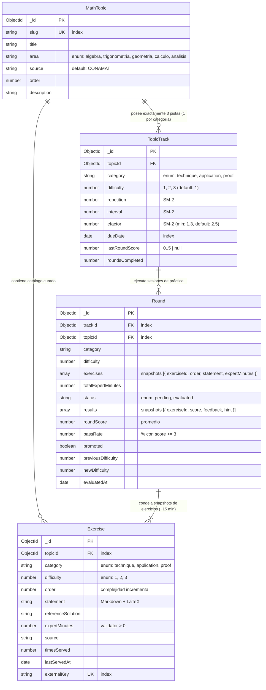
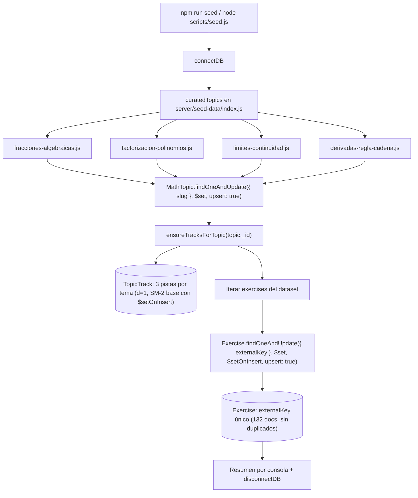
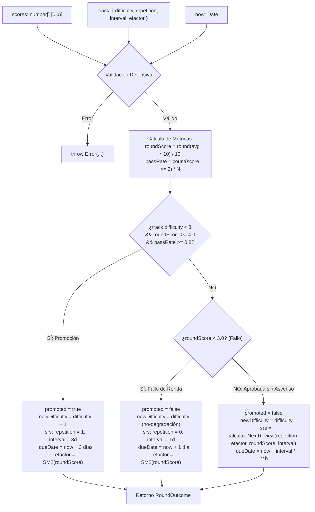

# Arquitectura Técnica del Sistema: MathCoach Sparring

Este documento describe la arquitectura modular, los contratos de API, el modelo de datos relacional sobre MongoDB/Mongoose y el flujo de evaluación multimodal de **MathCoach Sparring**.

---

## 1. Topología del Monorepo

El repositorio está estructurado como un monorepo NPM con separación estricta de responsabilidades entre cliente y servidor:

```text
mathcoach-sparring/
├── client/                     # Frontend SPA en Vite + React 18 + Tailwind CSS + KaTeX
│   ├── src/
│   │   ├── components/         # MathVisionUploader, MathStatement, Dashboard, RoundSession
│   │   ├── constants/          # categories.js (technique, application, proof)
│   │   ├── App.jsx             # Shell de navegación principal (Entrenar / Panel)
│   │   ├── main.jsx            # Entry point
│   │   └── index.css           # Estilos base y utilidades
│   ├── tests/                  # Pruebas unitarias e integración en Vitest + Testing Library
│   ├── index.html
│   ├── vite.config.js
│   └── package.json
├── server/                     # Backend API en Node.js (ESM) + Express + Mongoose
│   ├── src/
│   │   ├── config/             # categories.js, progression.js
│   │   ├── controllers/        # dashboardController.js (stub seguro hacia MATH-US-14)
│   │   ├── models/             # MathTopic.js, Exercise.js, TopicTrack.js, Round.js
│   │   ├── routes/             # health.js, topics.js, practice.js, rounds.js
│   │   ├── services/           # trackService.js, geminiService.js, roundBuilder.js
│   │   ├── utils/              # srsCalculator.js, progressionEngine.js
│   │   ├── app.js              # Express app y montaje de routers
│   │   ├── db.js               # Conexión defensiva a MongoDB con serverSelectionTimeoutMS
│   │   └── server.js           # Bootstrap del servidor HTTP
│   ├── tests/                  # Pruebas con Vitest, Supertest y MongoMemoryServer
│   │   ├── models.test.js      # Validación exhaustiva de los 4 modelos y trackService
│   │   ├── topics.test.js      # Validación del contrato GET /api/topics con pistas
│   │   ├── practice.test.js    # Evaluación multimodal POST /api/evaluate-math
│   │   └── srsCalculator.test.js
│   └── package.json
├── tests/
│   └── e2e/                    # Pruebas End-to-End con Playwright (math-vision.spec.js)
├── docs/                       # Documentación técnica (ARCHITECTURE.md, USER_GUIDE.md)
├── tickets/                    # Registro formal de especificaciones y evidencias de historias
├── graphify-out/               # Knowledge graph del repositorio generado por Graphify
├── playwright.config.js        # Orquestación de webServer y ejecución E2E
└── package.json                # Configuración de workspaces NPM y scripts globales
```

---

## 2. Modelo de Dominio y Esquemas de Persistencia (Mongoose)

El backend implementa la matriz tridimensional **Tema × Categoría × Dificultad** desacoplando la unidad conceptual (`MathTopic`) del ejercicio individual (`Exercise`), el seguimiento de memoria (`TopicTrack`) y la sesión de práctica (`Round`).



### 2.1 Esquema `MathTopic` (`server/src/models/MathTopic.js`)
Unidad curricular de contenido. No almacena enunciados particulares ni campos de repetición espaciada:
- **`slug`**: String único e indexado, normalizado en minúsculas (ej. `'fracciones-algebraicas'`).
- **`title`**: String requerido con el nombre legible del tema.
- **`area`**: Restringida estrictamente al enum: `['algebra', 'trigonometria', 'geometria', 'calculo', 'analisis']`.
- **`source`**: Cadena informativa (ej. `'CONAMAT'`, `'Stewart'`, `'Spivak'`).
- **`order`**: Orden pedagógico general dentro de su área matemática.
- **`description`**: Breve síntesis curricular de los conceptos abarcados.

### 2.2 Esquema `Exercise` (`server/src/models/Exercise.js`)
Problema concreto para ser resuelto en libreta física:
- **`topicId`**: Referencia obligatoria `ObjectId` hacia `MathTopic`.
- **`category`**: Enum `['technique', 'application', 'proof']`.
- **`difficulty`**: Entero `1`, `2` o `3`.
- **`order`**: Complejidad creciente dentro de su par *(categoría, dificultad)*.
- **`statement`**: Texto en Markdown con notación matemática LaTeX delimitada por `$ ... $` o `$$ ... $$`.
- **`referenceSolution`**: Criterio de resolución técnica y rubro para la evaluación con IA.
- **`expertMinutes`**: Número mayor a cero que representa los minutos estimados que un experto tarda en resolverlo. Validador defensivo: `v > 0`.
- **`timesServed`** y **`lastServedAt`**: Metadatos de rotación para evitar servir los mismos ejercicios repetidamente.
- **`externalKey`**: Cadena única e indexada para garantizar un sembrado (seeding) 100% idempotente (ej. `'alg-frac-tech-d1-01'`).
- **Índice Compuesto:** `{ topicId: 1, category: 1, difficulty: 1, order: 1 }` para selección y paginado instantáneo de rondas.

### 2.3 Esquema `TopicTrack` (`server/src/models/TopicTrack.js`)
Mantiene el progreso adaptativo para el par único *(Tema × Categoría)*:
- **`topicId`**: Referencia hacia `MathTopic`.
- **`category`**: Enum `['technique', 'application', 'proof']`.
- **`difficulty`**: Dificultad actual de la pista (`1`, `2` o `3`, por defecto `1`).
- **Campos SRS (SM-2):** `repetition` (default 0), `interval` (default 0), `efactor` (default 2.5, min 1.3), `dueDate` (Date, default `Date.now`).
- **Métricas:** `lastRoundScore` (0 a 5 o null) y `roundsCompleted` (conteo histórico).
- **Índice Compuesto Único:** `{ topicId: 1, category: 1 }` (garantiza que existan exactamente 3 pistas por tema).
- **Índice Secundario:** `{ dueDate: 1 }` para la consulta eficiente de la cola diaria de repasos.

### 2.4 Esquema `Round` (`server/src/models/Round.js`)
Sesión de práctica que agrupa ~15 minutos de tiempo experto:
- **Snapshots Inmutables:** Los ejercicios seleccionados se congelan en el array `exercises` (`exerciseId`, `order`, `statement`, `expertMinutes`), garantizando que la ronda no cambie aunque el catálogo se actualice.
- **Estado:** `status: 'pending'` (en progreso de resolución por el alumno) o `'evaluated'` (calificada por la IA).
- **Resultados:** `results` almacena los puntajes individuales (0 a 5), `feedback_paso_a_paso` y pistas socráticas.
- **Veredicto:** `roundScore`, `passRate`, `promoted`, `previousDifficulty`, `newDifficulty` y `evaluatedAt`.

---

## 3. Servicio Idempotente `ensureTracksForTopic`

Ubicado en `server/src/services/trackService.js`, garantiza que cualquier tema nuevo cuente de inmediato con sus 3 pistas operativas sin duplicar documentos ni reiniciar el avance existente:

```javascript
export async function ensureTracksForTopic(topicId) {
  if (!topicId) throw new Error('topicId is required');

  const tracks = await Promise.all(
    VALID_CATEGORIES.map(async (category) => {
      return TopicTrack.findOneAndUpdate(
        { topicId, category },
        {
          $setOnInsert: {
            topicId,
            category,
            difficulty: 1,
            repetition: 0,
            interval: 0,
            efactor: 2.5,
            dueDate: new Date(),
            lastRoundScore: null,
            roundsCompleted: 0,
          },
        },
        { upsert: true, new: true, setDefaultsOnInsert: true }
      );
    })
  );

  return tracks;
}
```

---

## 4. Pipeline de Siembra Idempotente y Catálogo Curado (`server/scripts/seed.js`)

Para asegurar la disponibilidad inmediata de material pedagógico formal sin recurrir a scripts monolíticos frágiles, el sistema cuenta con un pipeline de siembra desacoplado y estrictamente idempotente.



### 4.1 Modularidad de Datasets Curados (`server/seed-data/`)

Los datos están divididos en archivos independientes por tema matemático que exportan un contrato común `{ slug, metadata, exercises }`:
- **`fracciones-algebraicas.js`**: Álgebra CONAMAT (33 ejercicios).
- **`factorizacion-polinomios.js`**: Álgebra CONAMAT (33 ejercicios).
- **`limites-continuidad.js`**: Cálculo / Análisis Stewart / Spivak (33 ejercicios).
- **`derivadas-regla-cadena.js`**: Cálculo / Análisis Stewart / Spivak (33 ejercicios).
- **`index.js`**: Reúne y exporta el array canónico `curatedTopics`.

### 4.2 Estrategia de Idempotencia Estricta con `externalKey`

1. **Upsert Atómico de Temas:**
   - Criterio de unicidad: `{ slug: topicData.slug }`.
   - Modificador: `$set` con los atributos `metadata` (`title`, `area`, `source`, `order`, `description`).
2. **Inicialización de Pistas (`ensureTracksForTopic`):**
   - Emplea `$setOnInsert` para inicializar dificultad en 1 y valores SM-2 base (`repetition: 0, interval: 0, efactor: 2.5`). Si el estudiante ya tiene un progreso de repaso acumulado, este no se sobreescribe ni se reinicia.
3. **Upsert Atómico de Ejercicios por `externalKey`:**
   - Criterio de unicidad: `{ externalKey: exData.externalKey }` (ej. `'alg-frac-tech-d1-01'`).
   - Modificador: `$set` asociando `topicId: topic._id`, `category`, `difficulty`, `order`, `statement`, `referenceSolution`, `expertMinutes` y `source`.
   - Modificador `$setOnInsert`: Establece `timesServed: 0` y `lastServedAt: null`. De este modo, re-ejecutar el seed en un entorno en producción conserva los contadores de servicio y rotación de ejercicios.
4. **Duplicidad Cero ($\Delta N = 0$):**
   - Ejecutar `npm run seed` $N$ veces consecutivas mantiene exactamente:
     $$\Delta N_{\text{MathTopic}} = 0, \quad \Delta N_{\text{TopicTrack}} = 0, \quad \Delta N_{\text{Exercise}} = 0$$

### 4.3 Garantía de Volumen para el Constructor de Rondas

El diseño del catálogo garantiza las cuotas operativas exigidas por la regla de negocio §1.1 para armar rondas de ~15 minutos de tiempo experto:

| Categoría | Presupuesto por Ronda | Cuota Mínima por (Tema, Dificultad) | Minutos Mínimos por (Tema, Dificultad) | Capacidad de Generación Disjunta |
|---|---|---|---|---|
| **Técnica** | 3 a 10 ejercicios ($\ge 15$ min) | 6 ejercicios | $\ge 30$ min acumulados | Permite armar Ronda 1 ($\ge 3$ ex, $\ge 15$ min) y Ronda 2 ($\ge 3$ ex, $\ge 15$ min) **sin repetir ejercicios**. |
| **Aplicación** | 1 a 3 ejercicios ($\sim 15$ min) | 3 ejercicios | $\ge 20$ min acumulados | Permite armar al menos 2 rondas de aplicación distintas. |
| **Demostración** | Exactamente 1 ejercicio (8–15 min) | 2 ejercicios | $\ge 16$ min acumulados | Ronda 1 consume el primer problema; Ronda 2 consume el segundo de forma disjunta. |

---

## 5. Motor de Progresión Adaptativa y Acoplamiento SRS (`progressionEngine.js`)

El módulo `server/src/utils/progressionEngine.js` gobierna la progresión de dificultad y el cálculo de la próxima fecha de repaso tras evaluar una ronda de práctica.

Está diseñado siguiendo el patrón arquitectónico de **núcleo funcional puro (Functional Core)**:
- **Cero Efectos Secundarios:** No realiza operaciones de entrada/salida (E/S), no accede a colecciones de MongoDB ni interactúa con Express o llamadas a modelos de IA.
- **Determinismo y Testabilidad:** El 100% de sus cómputos son funciones puras $f(\text{scores}, \text{track}, \text{now}) \to \text{outcome}$, lo que permite pruebas unitarias instantáneas con Vitest y reproducibilidad matemática total.



### 5.1 Centralización de Constantes y Umbrales (`server/src/config/progression.js`)

Todos los valores numéricos y reglas de corte están desacoplados del código algorítmico y centralizados en `server/src/config/progression.js`:

```javascript
export const PROMOTION_MIN_SCORE = 4.0;       // Nota promedio mínima para promoción (escala 0-5)
export const PROMOTION_MIN_PASS_RATE = 0.8;    // Proporción mínima de ejercicios aprobados (>= 3)
export const PROMOTION_INTERVAL_DAYS = 3;      // Intervalo de repaso corto tras ascender de nivel
export const ROUND_BUDGET_MIN = 15;            // Presupuesto experto por ronda (minutos)
export const EXERCISE_PASS_SCORE = 3;          // Corte individual de ejercicio aprobado
export const ROUND_PASS_SCORE = 3.0;           // Corte global para evitar reinicio SM-2
export const MIN_DIFFICULTY = 1;               // Dificultad base
export const MAX_DIFFICULTY = 3;               // Tope adaptativo máximo
export const CATEGORY_LIMITS = {
  technique: { min: 3, max: 10 },
  application: { min: 1, max: 3 },
  proof: { min: 1, max: 1 },
};
```

### 5.2 Contrato Funcional de `computeRoundOutcome`

```typescript
interface ComputeRoundOutcomeParams {
  scores: number[];                          // Calificaciones individuales de la ronda (0 a 5)
  track: {
    difficulty: number;                      // 1, 2 o 3 (obligatorio)
    repetition?: number;                     // Etapa de repeticiones previas (default: 0)
    interval?: number;                       // Intervalo previo en días (default: 0)
    efactor?: number;                        // Factor de facilidad previo (min 1.3, default: 2.5)
  };
  now?: Date | number;                       // Instante base inyectable (default: new Date())
}

interface RoundOutcome {
  roundScore: number;                        // Promedio aritmético redondeado formalmente a 1 decimal
  passRate: number;                          // Proporción de ejercicios con calificación >= 3 (0.0 a 1.0)
  promoted: boolean;                         // true si asciende a la siguiente dificultad
  newDifficulty: number;                     // 1, 2 o 3 (garantía: newDifficulty >= track.difficulty)
  srs: {
    repetition: number;                      // Etapa SM-2 resultante
    interval: number;                        // Intervalo en días hasta el próximo repaso
    efactor: number;                         // Factor de facilidad actualizado (>= 1.3)
    dueDate: Date;                           // Fecha exacta del próximo repaso
  };
}
```

### 5.3 Matriz de Acoplamiento Bidireccional: Dificultad Adaptativa vs. Algoritmo SM-2

| Escenario Pedagógico | Regla Lógica | Efecto en Dificultad | Efecto en Motor SRS SM-2 | Justificación de Aprendizaje |
|---|---|---|---|---|
| **Fallo de Ronda** | `roundScore < 3.0` | Se mantiene (`newDifficulty = track.difficulty`) | **Reinicio SM-2:** `repetition = 0`, `interval = 1` día, `dueDate = now + 1d`. Ajuste de penalización en `efactor` según fórmula SM-2 sobre `Math.round(roundScore)`. | No se degrada la dificultad, pero se exige repaso correctivo al día siguiente para consolidar bases. |
| **Aprobada sin Promoción** | `roundScore >= 3.0` y `!promoted` (p. ej. `roundScore < 4.0` o `passRate < 0.8`) | Se mantiene (`newDifficulty = track.difficulty`) | **SM-2 Estándar:** Delega a `calculateNextReview(track.repetition, track.efactor, Math.round(roundScore), track.interval)`. | El estudiante se consolida en la dificultad actual espaciando las sesiones gradualmente. |
| **Promoción Exitosa** | `track.difficulty < 3` y `roundScore >= 4.0` y `passRate >= 0.8` | **Asciende:** `newDifficulty = track.difficulty + 1`, `promoted = true` | **Repaso rápido:** `repetition = 1`, `interval = PROMOTION_INTERVAL_DAYS` (3 días), `dueDate = now + 3d`. `efactor` actualizado positivamente con SM-2. | Desafío de nivel superior requiere afianzamiento inicial más rápido (3 días) antes de espaciar. |
| **Dificultad 3 (Tope Máximo)** | `track.difficulty === 3` y `roundScore >= 4.0` | Se mantiene en tope (`newDifficulty = 3`, `promoted = false`) | **SM-2 Estándar de Maestría:** Escala exponencialmente con intervalos largos (6, 15, 30+ días) según su `efactor`. | El estudiante alcanzó el nivel máximo del catálogo en esta pista; se entrena retención a largo plazo. |

---

## 6. Contratos de API Activos

### 6.1 `GET /api/topics`
Devuelve el catálogo de temas ordenados, enriquecidos dinámicamente con sus 3 pistas asociadas:
- **Ruta:** `/api/topics`
- **Respuesta (200 OK):**
```json
[
  {
    "_id": "674c11112222333344440001",
    "slug": "fracciones-algebraicas",
    "title": "Fracciones Algebraicas",
    "area": "algebra",
    "source": "CONAMAT",
    "order": 1,
    "description": "Simplificación, operaciones racionales y descomposición.",
    "tracks": [
      {
        "_id": "674c11112222333344440101",
        "category": "technique",
        "difficulty": 1,
        "dueDate": "2026-10-09T23:00:00.000Z",
        "lastRoundScore": null,
        "roundsCompleted": 0
      },
      {
        "_id": "674c11112222333344440102",
        "category": "application",
        "difficulty": 1,
        "dueDate": "2026-10-09T23:00:00.000Z",
        "lastRoundScore": null,
        "roundsCompleted": 0
      },
      {
        "_id": "674c11112222333344440103",
        "category": "proof",
        "difficulty": 1,
        "dueDate": "2026-10-09T23:00:00.000Z",
        "lastRoundScore": null,
        "roundsCompleted": 0
      }
    ]
  }
]
```

### 6.2 `POST /api/evaluate-math`
Evalúa la imagen manuscrita de un ejercicio con Gemini 1.5 Pro y actualiza el motor SRS:
- **Ruta:** `/api/evaluate-math`
- **Body:** `{ "problemId": "...", "image": "data:image/jpeg;base64,...", "metadata": { ... } }`
- **Respuesta (200 OK):**
```json
{
  "success": true,
  "score": 4,
  "feedback_paso_a_paso": "Procedimiento ordenado...",
  "hint": "Recuerda factorizar antes de simplificar.",
  "srs": {
    "repetition": 1,
    "interval": 1,
    "efactor": 2.5,
    "dueDate": "2026-10-10T18:00:00.000Z"
  }
}
```

### 6.3 `GET /api/dashboard/summary`
Stub seguro y compatible que previene rupturas en la interfaz hasta el rediseño de MATH-US-14:
```json
{
  "dueCount": 0,
  "criticalTopics": [],
  "recommendedNext": null
}
```

### 6.4 `GET /api/health`
Monitorea la salud del servicio y el estado de la base de datos (con fallback `degraded` si Mongo se ejecuta en modo standalone).

---

## 7. Certificación de la Purga Definitiva de DevCoach

Se certifica formalmente la erradicación de toda la deuda técnica heredada del prototipo anterior:
1. **Modelos Eliminados:** Se purgaron definitivamente `Topic.js` y `SessionLog.js`.
2. **Rutas Eliminadas:** Se removieron `routes/softSkillPractice.js`, `routes/codingPractice.js` y los endpoints de texto legados en `routes/practice.js`.
3. **Servicios Eliminados:** Se eliminó `services/softSkillSparringService.js` y las funciones no matemáticas de `geminiService.js`.
4. **Cero Coincidencias en Auditoría Grep:**
   ```bash
   grep -ri "junior\|senior\|soft_skill\|hard_skill\|SessionLog" server/src
   # Resultado: Salida vacía (código de salida 1)
   ```
5. **Frontend Libre de Residuos:** Eliminación de pestañas de simulación conversacional, dependencias de Monaco Editor y filtros de seniority.
