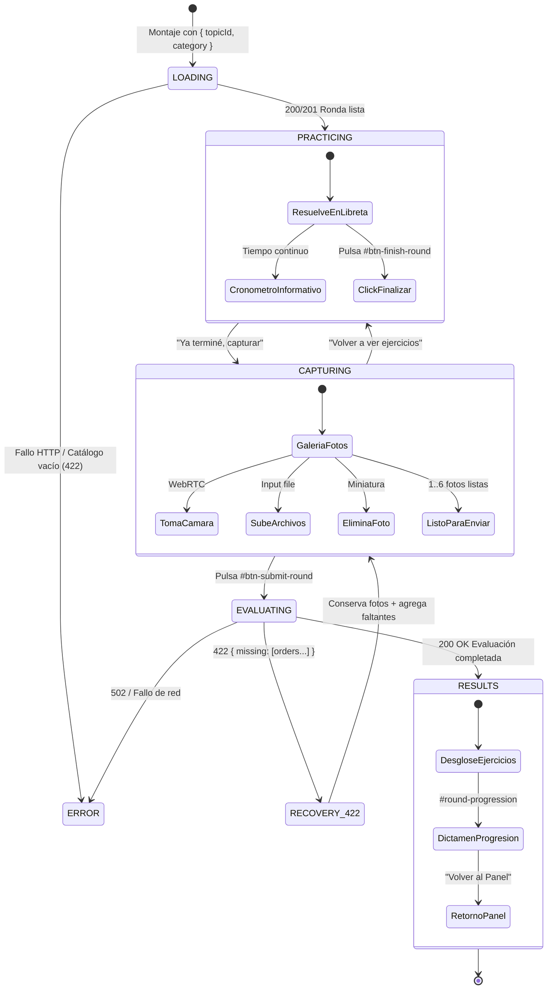

# [MATH-US-13] UI de Sesión de Ronda (RoundSession.jsx)

- **Estado:** Resuelto
- **Rama:** `feature/MATH-US-13-round-session-ui`
- **Fecha de Inicio:** 2026-10-09
- **Fecha de Cierre:** 2026-10-09

---

## 1. Descripción y Objetivos de Negocio

### 1.1 Contexto Arquitectónico y Razón de Cambio

La culminación de [[MATH-US-11] Constructor de Rondas](file:///home/teran/proyectos/mathcoach-sparring/tickets/MATH-US-11-round-builder.md) y [[MATH-US-12] Evaluación Multimodal de Rondas + Progresión](file:///home/teran/proyectos/mathcoach-sparring/tickets/MATH-US-12-round-evaluation.md) proveyó al backend de **MathCoach Sparring** de una infraestructura de práctica deliberada robusta:
1. Endpoints para instanciar rondas inmutables de ~15 minutos de tiempo experto (`POST /api/rounds`) compuestas algorítmicamente por [buildRound](file:///home/teran/proyectos/mathcoach-sparring/server/src/services/roundBuilder.js#L106-L142).
2. Pipeline de evaluación multimodal con Gemini 1.5 Pro (`POST /api/rounds/:id/evaluate`) capaz de auditar de 1 a 6 imágenes fotográficas en simultáneo, computar el resultado adaptativo con [computeRoundOutcome](file:///home/teran/proyectos/mathcoach-sparring/server/src/utils/progressionEngine.js#L47-L149), mutar el estado de la pista ([TopicTrack](file:///home/teran/proyectos/mathcoach-sparring/server/src/models/TopicTrack.js)) y reportar errores de detección (código HTTP 422 con array `missing`).

Sin embargo, el cliente web frontend ([client/src/App.jsx](file:///home/teran/proyectos/mathcoach-sparring/client/src/App.jsx) y [client/src/components/MathVisionUploader.jsx](file:///home/teran/proyectos/mathcoach-sparring/client/src/components/MathVisionUploader.jsx)) permanece anclado al flujo legado atómico de *"un ejercicio = una foto"*:
- **Fricción cognitiva constante:** Asume que el estudiante resuelve un solo problema y de inmediato toma una foto, rompiendo la inmersión de resolución continua en papel.
- **Incompatibilidad de modelo:** No contempla la noción de ronda de práctica, ni el orden secuencial de ejercicios crecientes, ni la dificultad adaptativa ni la rúbrica por categoría (*Técnica*, *Aplicación*, *Demostración*).
- **Captura mono-imagen:** Sólo permite capturar o subir una única fotografía, imposibilitando enviar soluciones extensas de 2 a 6 páginas de libreta.
- **Sin manejo de ejercicios no encontrados (422):** Si la IA omite un ejercicio, el cliente no informa qué problema falta ni permite anexar páginas adicionales sin reiniciar todo el proceso.
- **Ausencia de pantalla de resultados de ronda:** No existe una vista integral que detalle las calificaciones por ejercicio, la retroalimentación analítica paso a paso, el dictamen de progresión (subida o permanencia de dificultad) y la fecha del próximo repaso espaciado SM-2.

Esta historia de usuario implementa la **interfaz principal de entrenamiento de MathCoach Sparring**, sustituyendo definitivamente el flujo legado en la pestaña "Entrenar".

---

### 1.2 Arquitectura de Componentes y Descomposición Modular

Se diseñan y refactorizan los siguientes módulos en `client/src/`:

```
┌─────────────────────────────────────────────────────────────────────────────┐
│                             client/src/App.jsx                              │
│                    (Pestaña "Entrenar" | Pestaña "Panel")                   │
└──────────────────────────────────────┬──────────────────────────────────────┘
                                       │
                                       ▼
┌─────────────────────────────────────────────────────────────────────────────┐
│                  client/src/components/RoundSession.jsx                     │
│                 (Orquestador de Máquina de Estados de Ronda)                 │
│                                                                             │
│  [Estado: LOADING] ──> [Estado: PRACTICING] ──> [Estado: CAPTURING]         │
│                              │                         │                    │
│                              │ #round-header           │ RoundPhotoCapture  │
│                              │ #round-exercise-<order> │ (1 a 6 fotos)      │
│                              │ #btn-finish-round       │ #btn-submit-round  │
│                              │                         │                    │
│  [Estado: RESULTS] <── [Estado: EVALUATING] <──────────┘                    │
│         │                                                                   │
│         ▼                                                                   │
│  RoundResults.jsx                                                           │
│  #round-results / #round-progression / Desglose por ejercicio               │
│                                                                             │
│  [Estado: RECOVERY_422] (Si faltan ejercicios, conserva fotos y anexa)      │
└─────────────────────────────────────────────────────────────────────────────┘
```

1. **`client/src/components/RoundSession.jsx` (Orquestador Principal):**
   - Controla el ciclo de vida completo de la sesión de práctica a través de una máquina de estados finita explícita (`LOADING`, `PRACTICING`, `CAPTURING`, `EVALUATING`, `RECOVERY_422`, `RESULTS`, `ERROR`).
   - Consume los servicios de backend `POST /api/rounds` y `POST /api/rounds/:id/evaluate`.
   - Coordina la presentación del encabezado de la ronda, la lista numerada de ejercicios, el cronómetro no bloqueante, el modal/pantalla de captura y la transición a la pantalla de resultados.

2. **`client/src/components/RoundResults.jsx` (Resultados y Progresión):**
   - Pantalla dedicada a visualizar el balance pedagógico de la ronda finalizada.
   - Presenta la calificación global (`roundScore`), tasa de aprobación (`passRate`) y veredicto adaptativo (`promoted`, dificultades anterior y nueva).
   - Comunica de forma transparente el agendamiento del próximo repaso espaciado (`nextReviewAt`).
   - Ofrece desglose interactivo o secuencial de cada ejercicio evaluado (`order`, `score`, `feedback_paso_a_paso`, `hint`).

3. **`client/src/components/RoundPhotoCapture.jsx` (o refactorización modular de `MathVisionUploader.jsx`):**
   - Componente especializado en la captura y gestión de 1 a 6 fotografías de libreta.
   - Integra acceso a cámara web mediante WebRTC (`navigator.mediaDevices.getUserMedia`), alternancia de cámaras (trasera/frontal) y congelamiento a Canvas JPEG Base64.
   - Integra input de archivos `<input type="file" multiple accept="image/*">` para subida manual o móvil.
   - Provee galería visual de miniaturas (thumbnails) con opciones para eliminar imágenes individuales y añadir nuevas páginas hasta alcanzar el límite máximo de 6 fotos.
   - Preserva las fotografías cargadas en caso de error 422 para facilitar la captura incremental.

4. **Integración en `client/src/App.jsx`:**
   - Monta `RoundSession.jsx` directamente en la pestaña "Entrenar" (`tab-math-vision`).
   - Permite recibir `topicId` y `category` desde la navegación del panel o inicializar con la pista activa/recomendada del sistema.

---

### 1.3 Ciclo de Vida y Máquina de Estados de la Sesión



#### Fases Detalladas:

1. **Carga Inicial (`LOADING`):**
   - Se realiza petición HTTP `POST /api/rounds` enviando `{ topicId, category }`.
   - Si ya existía una ronda `pending` para la pista, el backend responde `200 OK` reutilizándola (idempotencia). Si no, genera una nueva con `201 Created`.
   - Se procesan los datos devueltos: `roundId`, `topic: { _id, title, slug }`, `category`, `difficulty`, `exercises` y `totalExpertMinutes`.
   - En caso de error de red o catálogo insuficiente sin ejercicios, se muestra estado de error amigable con botón para reintentar o volver al panel.

2. **Encabezado Informativo (`#round-header`):**
   - Muestra el título del tema matemático (`topic.title`).
   - Muestra la categoría traducida al español mediante [client/src/constants/categories.js](file:///home/teran/proyectos/mathcoach-sparring/client/src/constants/categories.js) (`Técnica`, `Aplicación`, `Demostración`).
   - Muestra la dificultad actual (1, 2 o 3) con indicador visual (badges/estrellas).
   - Despliega la leyenda de tiempo de referencia: *"Un experto lo resuelve en ~15 min"* (o basado en `totalExpertMinutes`).

3. **Visualización de Problemas (`PRACTICING`):**
   - Lista numerada de los ejercicios de la ronda, presentados en orden de complejidad creciente (`order` ascendente: 1, 2, ... N).
   - Cada ejercicio se renderiza dentro de un contenedor con id único `#round-exercise-<order>` utilizando el componente [MathStatement](file:///home/teran/proyectos/mathcoach-sparring/client/src/components/MathStatement.jsx) con soporte KaTeX para fórmulas matemáticas.
   - Muestra un cronómetro informativo opcional (tiempo transcurrido `MM:SS`), diseñado para no bloquear ni generar estrés punitivo en el estudiante.

4. **Flujo de Entrega y Captura Multimodal (`CAPTURING`):**
   - Al finalizar el trabajo en papel, el estudiante presiona el botón `#btn-finish-round` con la leyenda *"Ya terminé, capturar"*.
   - Se despliega la interfaz de captura multimodal que admite de **1 a 6 fotos**:
     - Acceso directo a cámara WebRTC con botón de captura.
     - Selector alternativo de archivos para cargar imágenes ya tomadas en teléfono móvil o tableta.
     - Galería de miniaturas donde se visualizan las páginas agregadas con contador (`X de 6 fotos`), botón para descartar/eliminar foto individual y botón para capturar/subir páginas adicionales.
   - Botón `#btn-submit-round` con la leyenda *"Enviar a evaluar"*, habilitado únicamente cuando se ha cargado al menos 1 fotografía.

5. **Manejo Resiliente de Error HTTP 422 (`RECOVERY_422`):**
   - Si la IA evaluadora no detecta alguno de los ejercicios de la ronda en las fotos enviadas, el backend responde `422 Unprocessable Entity` con payload `{ error: 'exercises_not_found', missing: [2, 4] }`.
   - La UI entra en modo de recuperación sin reiniciar la ronda ni desechar las imágenes ya capturadas.
   - Se presenta una alerta destacada: *"La IA no encontró el procedimiento de los siguientes ejercicios: #2, #4. Por favor agrega una foto más clara o la hoja donde los resolviste"*.
   - El estudiante puede agregar fotografías adicionales (hasta el límite de 6) o reemplazar fotos ilegibles y reenviar la evaluación mediante `#btn-submit-round`.

6. **Pantalla de Resultados y Progresión (`RESULTS` en `RoundResults.jsx`):**
   - Contenedor principal identificado con `#round-results`.
   - **Score de Ronda y Tasa de Aprobación:** Puntuación global `roundScore` (0.0 a 5.0) y porcentaje de ejercicios aprobados (`passRate`).
   - **Veredicto Adaptativo (`#round-progression`):**
     - Si `promoted === true`: Mensaje de ascenso: *"¡Felicidades! Subes a dificultad X en [Categoría] para el próximo repaso"*.
     - Si `promoted === false`: Mensaje de permanencia: *"Te mantienes en dificultad Y en [Categoría]"*.
     - Fecha agendada para el próximo repaso según el motor SM-2 (`nextReviewAt` formateada de manera amigable).
   - **Desglose Individual de Ejercicios:**
     - Calificación numérica (0 a 5) y badge pedagógico.
     - Retroalimentación paso a paso detallada (`feedback_paso_a_paso`).
     - Sugerencia didáctica / pista metodológica (`hint`).
   - Botones de acción para retornar al Panel o iniciar una nueva práctica.

---

### 1.4 Contrato Estricto de Identificadores Estables para E2E

Para garantizar pruebas de integración y automatización Playwright ([MATH-US-15](file:///home/teran/proyectos/mathcoach-sparring/.antigravity/graph.md#L250-L258)) 100% deterministas y libres de fragilidad por selectores CSS dinámicos, se establece el siguiente contrato obligatorio de atributos `id`:

| Identificador Requerido | Elemento HTML | Propósito en el Flujo |
|---|---|---|
| `#round-header` | `<header>` / `<div>` | Encabezado principal que contiene el tema, categoría en español, dificultad activa y tiempo de referencia. |
| `#round-exercise-<order>` | `<div>` / `<article>` | Contenedor de cada ejercicio de la ronda según su número ordinal (ej. `#round-exercise-1`, `#round-exercise-2`). |
| `#btn-finish-round` | `<button>` | Botón que concluye la resolución y abre la interfaz de captura ("Ya terminé, capturar"). |
| `#btn-submit-round` | `<button>` | Botón que envía las 1 a 6 fotografías a evaluar al endpoint del servidor ("Enviar a evaluar"). |
| `#round-results` | `<div>` / `<section>` | Contenedor principal de la pantalla de resultados y feedback detallado. |
| `#round-progression` | `<div>` | Bloque que despliega el dictamen adaptativo de progresión (subida/permanencia) y fecha del próximo repaso SRS. |

#### Identificadores de Soporte Adicionales:
- `#round-timer`: Contenedor del cronómetro informativo.
- `#photo-capture-gallery`: Contenedor de la galería de miniaturas de fotos capturadas.
- `#btn-add-photo`: Botón para disparar captura o abrir selector de archivo adicional.
- `#alert-missing-exercises`: Contenedor de la advertencia de error 422 indicando ejercicios faltantes.
- `#round-exercise-result-<order>`: Contenedor del desglose de evaluación para cada ejercicio en `RoundResults`.

---

## 2. Criterios de Aceptación (AC)

- [x] **AC-1:** Al entrar con `{ topicId, category }` llama `POST /api/rounds` y muestra encabezado: tema, categoría (etiqueta en español), dificultad (1–3) y tiempo de referencia ("Un experto lo resuelve en ~15 min").
- [x] **AC-2:** Lista numerada de enunciados con `MathStatement` (KaTeX), en el orden de la ronda (incremental). Cronómetro informativo opcional (no bloquea).
- [x] **AC-3:** Botón "Ya terminé, capturar" → captura 1..6 fotos (cámara o archivo) con miniaturas, posibilidad de borrar/añadir, y envío a `POST /api/rounds/:id/evaluate`.
- [x] **AC-4:** Manejo de `422`: indica qué ejercicios no se encontraron y permite añadir otra foto y reenviar.
- [x] **AC-5:** `RoundResults` muestra score por ejercicio con feedback y hint, `roundScore`, mensaje de progresión ("Subes a dificultad 2 en Técnica para el próximo repaso" / "Te mantienes en dificultad 1") y fecha del próximo repaso.
- [x] **AC-6:** Ids estables para E2E: `#round-header`, `#round-exercise-<order>`, `#btn-finish-round`, `#btn-submit-round`, `#round-results`, `#round-progression`.
- [x] **AC-7:** Tests Vitest con `fetch` mockeado para los estados: cargando, lista, captura, evaluando, 422, resultados.

---

## 3. Subgrafo Afectado (Identificado con Graphify)

- **Nodos del Grafo:**
  - `[MATH-US-13] UI de Sesión de Ronda (RoundSession.jsx)`
  - `RoundSession`
  - `RoundResults`
  - `RoundPhotoCapture` / `MathVisionUploader`
  - `MathStatement`
  - `App`
  - `CATEGORIES` (`client/src/constants/categories.js`)
  - `POST /api/rounds` ([rounds.js](file:///home/teran/proyectos/mathcoach-sparring/server/src/routes/rounds.js#L76-L183))
  - `POST /api/rounds/:id/evaluate` ([rounds.js](file:///home/teran/proyectos/mathcoach-sparring/server/src/routes/rounds.js#L213-L395))

- **Archivos a Intervenir y Crear:**
  - `client/src/components/RoundSession.jsx` (Nuevo: orquestador de ronda y máquina de estados).
  - `client/src/components/RoundResults.jsx` (Nuevo: pantalla de resultados, feedback y progresión).
  - `client/src/components/RoundPhotoCapture.jsx` (Nuevo: galería multi-foto 1..6 con cámara y subida de archivos).
  - `client/src/components/MathVisionUploader.jsx` (Refactorizado con compatibilidad para colecciones de imágenes).
  - `client/src/App.jsx` (Integración de `RoundSession` en pestaña "Entrenar").
  - `client/src/constants/categories.js` (Uso de constantes `CATEGORIES` para etiquetas en español).
  - `client/tests/RoundSession.test.jsx` (Nuevo: suite integral de pruebas unitarias y de integración de estados).
  - `client/tests/RoundResults.test.jsx` (Nuevo: pruebas de renderizado de resultados, badges y progresión).
  - `client/tests/App.test.jsx` (Actualización de integración con la nueva pestaña "Entrenar").

---

## 4. Estrategia de Pruebas y Cobertura (Vitest + Testing Library)

Se diseñó una suite de pruebas en `client/tests/RoundSession.test.jsx` y `client/tests/RoundResults.test.jsx` utilizando `@testing-library/react` y Vitest, mockeando exhaustivamente `global.fetch` y `navigator.mediaDevices`:

1. **Estado `Cargando` (`LOADING`):**
   - Renderiza un skeleton o spinner mientras se resuelve `POST /api/rounds`.
   - Verifica que no se muestren prematuramente botones de captura o ejercicios.

2. **Estado `Lista de Ejercicios` (`PRACTICING`):**
   - Verifica presencia de `#round-header` con título del tema, etiqueta traducida ("Técnica", "Aplicación" o "Demostración"), dificultad activa y la leyenda de tiempo de referencia ("Un experto lo resuelve en ~15 min").
   - Verifica presencia de cada contenedor `#round-exercise-1`, `#round-exercise-2`, etc., ordenados por `order` ascendente con expresiones KaTeX renderizadas.
   - Verifica existencia del botón `#btn-finish-round` con texto "Ya terminé, capturar".
   - Verifica cronómetro visible no bloqueante.

3. **Estado `Captura de Fotografías` (`CAPTURING`):**
   - Al pulsar `#btn-finish-round`, la UI transiciona a la galería de captura.
   - Simula toma fotográfica con cámara o carga de archivos.
   - Comprueba que se rendericen las miniaturas de las fotos cargadas.
   - Comprueba eliminación de una foto individual y actualización del contador.
   - Verifica que `#btn-submit-round` esté deshabilitado con 0 fotos y habilitado con $\ge 1$ fotos.

4. **Estado `Evaluando` (`EVALUATING`):**
   - Al pulsar `#btn-submit-round`, muestra indicador de análisis con IA multimodal.

5. **Estado `Recuperación 422` (`RECOVERY_422`):**
   - Simula respuesta 422 con `{ error: 'exercises_not_found', missing: [2] }`.
   - Verifica alerta indicando claramente que falta el ejercicio 2.
   - Comprueba que las imágenes previamente cargadas no se borren.
   - Permite agregar una nueva fotografía y reenviar exitosamente.

6. **Estado `Resultados y Progresión` (`RESULTS`):**
   - Simula respuesta 200 con `roundScore`, `promoted`, `results` y `nextReviewAt`.
   - Verifica presencia de `#round-results`.
   - Verifica presencia de `#round-progression` con el texto de promoción adecuado ("Subes a dificultad 2 en Técnica..." o "Te mantienes en dificultad 1").
   - Verifica renderizado de score, feedback paso a paso y hint por cada ejercicio.

---

## 5. Evidencia de Pruebas (Completado por verify-user-story)

### Tests Unitarios e Integración (Vitest)

Ejecución de `npm test` sobre monorepo completo:
- **Server:** 9 suites pasadas, 100 pruebas unitarias/integración pasadas (100%).
- **Client:** 4 suites pasadas (`App.test.jsx`, `RoundSession.test.jsx`, `RoundResults.test.jsx`, `MathVisionUploader.test.jsx`), 22 pruebas pasadas (100%).

Total Monorepo: **122 pruebas pasadas en verde**.

### Tests E2E (Playwright)

`N/A EN ESTE TICKET UNITARIO/INTEGRACIÓN (LA SUITE INTEGRAL PLAYWRIGHT SE FORMALIZA EN MATH-US-15)`

---

## 6. Commit de Cierre en dev

- Rama: `feature/MATH-US-13-round-session-ui`
- Commit: `feat(client): implement RoundSession ui, multi-photo capture and adaptive results (MATH-US-13)`
